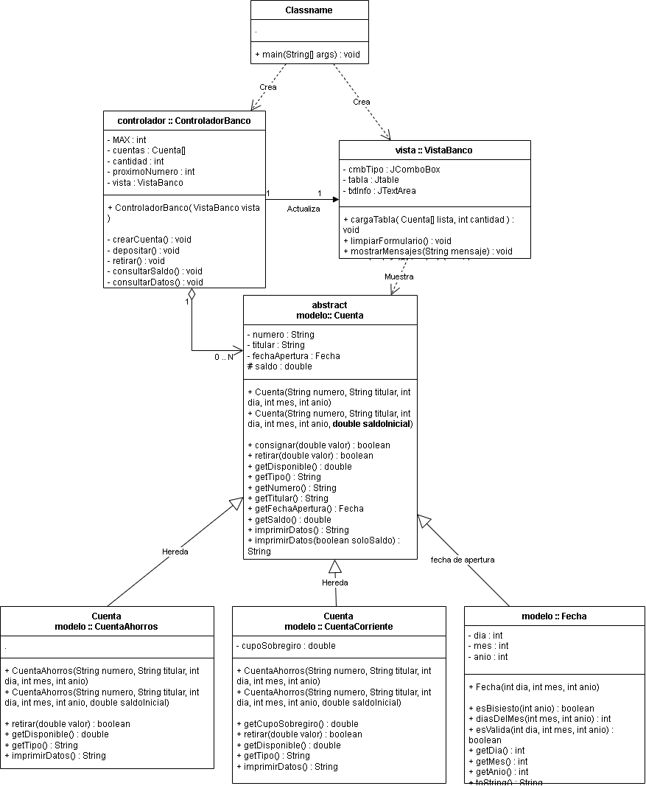
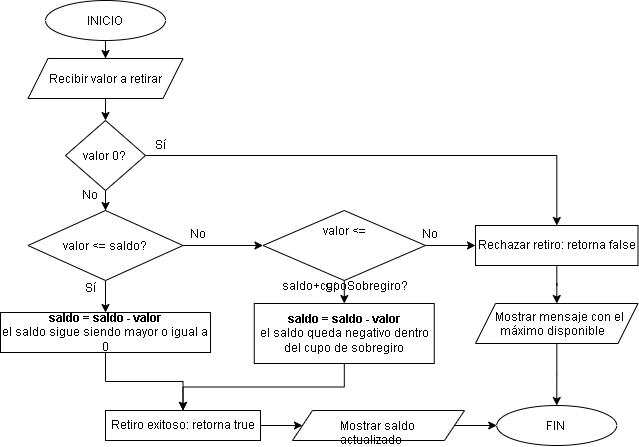

# sistema-bancario

Aplicación de escritorio para crear cuentas bancarias, consignar, retirar y consultar saldos e información. Está desarrollada con **Java 26**, **Swing/JFrame** y **Maven** (NetBeans 30), bajo el patrón **MVC** y sin librerías externas. Las fechas se manejan con una clase propia, `Fecha`.


## Requisitos

- JDK 26
- Apache NetBeans 30 (o cualquier IDE compatible con Maven)
- Maven (incluido en NetBeans)

## Estructura del proyecto

```
src/main/java/
├── modelo/
│   ├── Fecha.java
│   ├── Cuenta.java               (superclase abstracta)
│   ├── CuentaAhorros.java
│   └── CuentaCorriente.java
├── vista/
│   └── VistaBanco.java           (JFrame)
├── controlador/
│   └── ControladorBanco.java
└── SistemaBancario.java          (clase principal)
```

## Patrón MVC

| Capa | Clase | Responsabilidad |
|------|-------|-----------------|
| Modelo | `Fecha`, `Cuenta`, `CuentaAhorros`, `CuentaCorriente` | Datos y reglas de negocio (consignar, retirar, imprimir datos). |
| Vista | `VistaBanco` | Interfaz gráfica: formulario, tabla de cuentas y panel de operaciones. No contiene lógica de negocio. |
| Controlador | `ControladorBanco` | Valida los datos, asigna el número de cuenta, administra el arreglo de cuentas y ejecuta las operaciones solicitadas desde la vista. |
| Principal | `Main` | Crea la vista y el controlador e inicia la aplicación. |

La vista no conoce al controlador: el controlador se registra como oyente de los botones.

## Descripción de las clases

- **`Fecha`**: maneja día, mes y año de apertura. Valida años bisiestos y días por mes sin usar librerías (`esBisiesto`, `diasDelMes`, `esValida`).
- **`Cuenta` (abstracta)**: atributos compartidos (número, titular, fecha de apertura, saldo) y métodos `consignar()`, `imprimirDatos()` y los abstractos `retirar(double)`, `getDisponible()` y `getTipo()`.
- **`CuentaAhorros`**: solo permite retirar si `valor <= saldo`.
- **`CuentaCorriente`**: agrega `cupoSobregiro`; permite retirar si `valor <= saldo + cupoSobregiro`, y el saldo puede quedar negativo hasta ese límite.
- **`ControladorBanco`**: mantiene un arreglo `Cuenta[]` (máximo 50) con un contador y genera el número de cuenta de forma automática y consecutiva (desde 1001), lo que garantiza que no se repita y evita errores de digitación.
- **`VistaBanco`**: formulario de creación, tabla de solo lectura, panel de operaciones y área de texto con los resultados de las consultas.

## Conceptos de POO aplicados

- **Herencia y polimorfismo**: `CuentaAhorros` y `CuentaCorriente` heredan de `Cuenta`. El método abstracto `retirar(double valor)` se comporta distinto según la instancia, y el controlador siempre trabaja con variables de tipo `Cuenta`.
- **Composición**: cada `Cuenta` crea y posee su propia `Fecha` de apertura dentro de su constructor.
- **Clase abstracta**: `Cuenta` no se puede instanciar y obliga a las subclases a implementar `retirar`, `getDisponible` y `getTipo`.
- **Sobrecarga de constructores**: cada cuenta tiene un constructor sin saldo inicial (saldo 0) y otro con saldo inicial. En `CuentaCorriente` se suma el cupo de sobregiro.
- **Sobrecarga del método de impresión**: `imprimirDatos()` devuelve todos los datos e `imprimirDatos(boolean soloSaldo)` permite pedir solo el saldo.
- **Sobreescritura**: las subclases sobreescriben `imprimirDatos()` usando `super.imprimirDatos()` para agregar el tipo de cuenta (y el cupo y el disponible en la corriente). Además, en la vista se sobreescribe `isCellEditable` del modelo de la tabla para que sea de solo lectura.
- **Encapsulamiento**: atributos privados (o `protected` para el saldo) con acceso mediante métodos públicos.

## Diagrama de clases (UML)



**Relaciones y cardinalidades**

- **Herencia jerárquica**: `Cuenta` → `CuentaAhorros` y `CuentaCorriente`.
- **Composición `Cuenta` ◆— `Fecha` (1..1)**: la fecha no existe sin la cuenta que la crea.
- **Agregación `ControladorBanco` ◇— `Cuenta` (1..0..N)**: el controlador administra las cuentas, almacenadas en un arreglo.
- **Asociación `ControladorBanco` → `VistaBanco` (1..1)**: un controlador usa una única vista.

## Diagrama de flujo: retiro en cuenta corriente con sobregiro



Los dos últimos pasos antes del fin (reordenar y mostrar) los ejecuta el controlador; el cálculo del bonus y del ranking está en `Competidor`.

**Ejemplo**: saldo $100 y cupo de sobregiro $200.

| Retiro | Resultado | Saldo final |
|-------:|-----------|------------:|
| $80  | Aprobado (cubre el saldo) | $20 |
| $250 | Aprobado (usa sobregiro: 250 ≤ 100 + 200) | -$150 |
| $350 | Rechazado (excede 300) | $100 (sin cambio) |

En el código, las dos decisiones se resumen en una sola condición equivalente: `valor > 0 && valor <= saldo + cupoSobregiro`.

## Uso de la aplicación

1. **Crear cuenta**: elegir el tipo (Ahorros o Corriente), escribir titular, fecha de apertura (día, mes y año) y, opcionalmente, el saldo inicial. Para cuenta corriente, escribir también el cupo de sobregiro (el campo solo se habilita para ese tipo). El número de cuenta se asigna automáticamente. Pulsar **Crear cuenta**.
2. **Seleccionar** una cuenta en la tabla.
3. **Operar**: escribir el valor y pulsar **Depositar** o **Retirar**.
4. **Consultar**: **Consultar saldo** muestra solo el saldo; **Consultar datos** muestra toda la información de la cuenta. El resultado aparece en el área de texto inferior.

## Validaciones

- Titular obligatorio.
- Fecha de apertura válida (considera años bisiestos; año entre 1900 y 2100).
- Saldo inicial y cupo de sobregiro no negativos.
- Valores de depósito y retiro mayores que 0.
- Retiros rechazados con mensaje si exceden lo permitido (saldo en ahorros; saldo más cupo en corriente).
- Campos numéricos con formato válido y máximo de 50 cuentas.